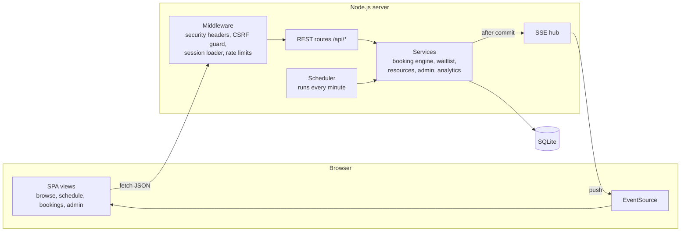
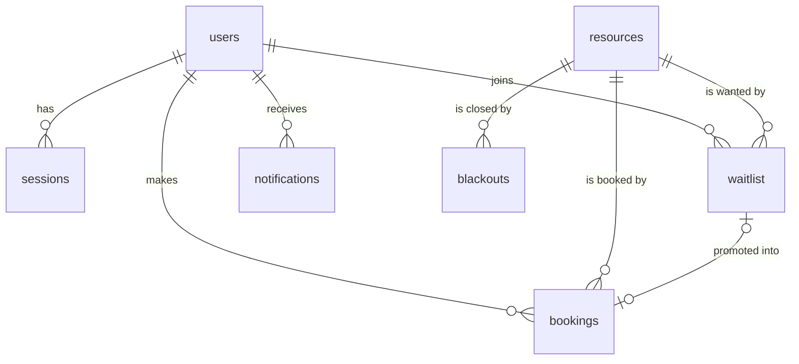

# SlotWise

**Fair, conflict-free booking for shared campus spaces and equipment.**

SlotWise lets students find and book study rooms, meeting rooms, labs, equipment and sports courts on a live schedule. It enforces fair-use rules, releases rooms that nobody shows up for, and automatically hands freed time to the people waiting for it. Administrators get tools to manage spaces, plan closures and see how the campus is actually used.

> Live demo: **`<add your deployed URL here>`**
> Demo video: **`<add your video link here>`**

---

## Problem Statement

Shared campus spaces are usually booked through spreadsheets, paper sign-up sheets or a first-come message on a group chat. This causes predictable problems:

- **Double bookings and disputes.** Two groups turn up for the same room because nothing checked for overlaps.
- **Ghost bookings.** A room is reserved "just in case" and sits empty while others are turned away. Nothing releases it.
- **Hoarding.** A few people reserve most of the prime hours and nobody enforces a limit.
- **No second chance.** When someone cancels, the people who wanted that slot never find out.
- **No visibility for staff.** Facilities teams cannot tell which rooms are under-used, when demand peaks, or how many bookings are no-shows.

## Target Users

- **Students** who need a quiet room, a group space, lab bench, camera kit or court at a specific time.
- **Facilities and administrative staff** who own those resources, schedule maintenance and want usage data to plan capacity.

## Solution

SlotWise turns the booking sheet into a rules-enforcing system:

| Problem | How SlotWise solves it |
| --- | --- |
| Double bookings | Every booking is validated and written inside a single database transaction. Overlaps are impossible, even under concurrent requests. |
| Ghost bookings | Users must **check in** within 15 minutes of the start. A background job releases unclaimed bookings as **no-shows**. |
| Repeat no-shows | Three no-shows within 30 days **pause booking rights** until the oldest strike ages out. |
| Hoarding | Students have a **weekly quota** of 10 hours and at most 5 upcoming bookings. |
| Missed cancellations | A **FIFO waitlist** automatically books the next eligible person when time frees up, and notifies them instantly. |
| Maintenance clashes | Admins create **blackout periods**. Colliding bookings are cancelled and owners notified in the same transaction. |
| No visibility | An **analytics dashboard** shows utilisation, no-show rates, cancellations and a weekday-by-hour demand heatmap. |

## Key Features

### For students
1. **Discover spaces.** Search by name, building or description. Filter by type, building, group size or "free right now".
2. **Book on a live grid.** Pick a date in the next 14 days, select a start and end slot, and book. The grid updates live when anyone else books or cancels.
3. **Join a waitlist.** Select time that is already taken to queue for it. If it frees up you are booked automatically and notified.
4. **Check in and manage bookings.** Check in on arrival, cancel bookings you no longer need, see past bookings and waitlist positions.
5. **Stay informed.** Real-time in-app alerts for waitlist promotions, reminders 30 minutes before a booking, no-show releases and admin changes.
6. **See your standing.** Weekly hours used, upcoming booking count and no-show strikes are always visible.

### For administrators
1. **Analytics dashboard** with utilisation per resource, no-show and cancellation rates, waitlist fills and a busy-hours heatmap.
2. **Resource management.** Create and edit spaces with capacity, opening hours, maximum booking length and amenities. Deactivating a resource safely cancels its future bookings and notifies the people affected.
3. **Blackout periods** for one resource or the whole campus, with automatic cancellation and notification.
4. **Booking oversight.** Filter all bookings by student, status, resource and date range, and cancel with a reason that is sent to the student.
5. **User management.** View booking history and strikes, and grant or revoke admin access.

### Booking rules (all enforced server-side)

| Rule | Default |
| --- | --- |
| Slot granularity | 30 minutes |
| Booking window | up to 14 days ahead |
| Maximum length | per resource (e.g. 3 h for study rooms, 1 h for courts) |
| Weekly quota (students) | 10 hours |
| Upcoming bookings (students) | 5 |
| Waitlist entries (students) | 5 |
| Check-in window | 10 min before to 15 min after start |
| No-show strikes | 3 in 30 days pauses booking |

All values live in [`src/config.js`](src/config.js).

## Tech Stack

| Layer | Choice | Why |
| --- | --- | --- |
| Runtime | **Node.js 22+** | One language across client and server. |
| HTTP | **Express 5** | Small, well understood, native async error handling. The only runtime dependency. |
| Database | **SQLite** via Node's built-in `node:sqlite` | Relational integrity, real transactions and zero setup or native builds. Ideal for a single-campus deployment. |
| Real-time | **Server-Sent Events** | One-way server pushes (notifications, schedule changes) without a WebSocket library. Browsers reconnect automatically. |
| Auth | Custom sessions + **scrypt** | Built-in `crypto`. No third-party auth needed for a campus-local account system. |
| Frontend | **Vanilla JavaScript ES modules**, hand-written CSS | No build step. Fast to load, easy to read, strict CSP friendly. |
| Tests | **`node:test`** | Built-in runner, no test dependencies. |
| Deployment | **Render** blueprint and a **Dockerfile** | Free public hosting, or any container platform. |

## Architecture



### Components

- **`src/db`**: database connection, ordered migrations and a `tx()` helper. Transactions nest using SAVEPOINTs, and `afterCommit()` defers side effects such as live pushes until data is durable. A failed booking never sends a phantom update.
- **`src/services/bookingService.js`**: the booking engine. Every request passes one rule pipeline: resource active, then slot alignment, opening hours, duration and booking window, then capacity and blackouts, then the user's overlap, suspension, active-booking cap and weekly quota, and finally the resource conflict check. It also handles cancellation, check-in and idempotent replays.
- **`src/services/waitlistService.js`**: joins, positions and promotion. Promotion walks the queue in arrival order and tries each entry in its own savepoint. One ineligible person, for example someone who has since booked elsewhere, never blocks the people behind them.
- **`src/services/resourceService.js`**: search, the free-now flag, the per-day slot grid and admin resource management.
- **`src/services/adminService.js`**: blackouts, booking oversight, user roles and analytics aggregation.
- **`src/jobs/scheduler.js`**: a minute-by-minute job that releases no-shows and offers the remaining time to the waitlist, completes finished sessions, sends reminders, expires stale waitlist entries and purges expired sessions. Every step is idempotent, so restarts are safe.
- **`src/lib/events.js`**: the Server-Sent Events hub. It sends notifications to one user and broadcasts schedule changes to everyone.
- **`public/`**: the single-page app. `api.js` wraps fetch with typed errors, `session.js` holds signed-in state and the event stream, and `views/` renders each screen with loading, empty, error and success states.

### Data model



- Times are stored as UTC epoch milliseconds. Opening hours, day boundaries and weekly quotas are evaluated in the campus timezone (`CAMPUS_TZ`), including correct handling of daylight-saving zones.
- Bookings move through `confirmed → checked_in → completed`, or end as `cancelled` or `no_show`.
- `UNIQUE(user_id, idempotency_key)` makes duplicate submissions harmless. A partial unique index prevents duplicate active waitlist entries.

### Engineering decisions worth noting

- **Race-free booking.** Rules and the insert run inside `BEGIN IMMEDIATE`, which takes SQLite's write lock up front. Two simultaneous requests for one slot are serialised, so the second sees the first and gets `SLOT_TAKEN`.
- **Idempotent writes.** The client sends an `Idempotency-Key` with each booking attempt and reuses it on retry. A double click or a retry after a dropped response returns the original booking instead of a duplicate.
- **Stable error codes.** Every failure returns `{ error: { code, message, details } }`. The UI reacts to specific codes, for example by refreshing the grid on `SLOT_TAKEN`, and shows field-level messages for `VALIDATION_ERROR`.
- **Authorization by ownership.** Users can only see and act on their own bookings. Requests for someone else's booking return 404 so ids are not leaked.

### Security

- Passwords hashed with salted **scrypt**, compared in constant time. Unknown emails take the same time as wrong passwords.
- Session tokens are 256-bit random values. Only their SHA-256 hash is stored. Cookies are `HttpOnly`, `SameSite=Lax`, and `Secure` in production.
- **CSRF protection**: all state-changing API calls require an `X-Requested-With` header that cross-site forms cannot send.
- Strict **Content-Security-Policy** with no inline scripts or styles, plus `nosniff`, `X-Frame-Options: DENY` and a same-origin referrer policy.
- All user content is HTML-escaped before rendering. All input is validated server-side. SQL uses bound parameters only, and `LIKE` wildcards are escaped.
- Sign-in and registration are rate limited. Changing a user's role revokes their sessions.
- Secrets come from environment variables. `.env` is git-ignored and `.env.example` documents every variable.

## Local Setup

Requirements: **Node.js 22.13 or newer** (it includes the built-in SQLite driver). Nothing else is needed.

```bash
git clone <your-repo-url> slotwise
cd slotwise
npm install
cp .env.example .env        # optional: adjust settings
npm start                   # http://localhost:3000
```

On first start the database is created in `./data/` and seeded with demo resources, students and 30 days of booking history.

| Account | Email | Password |
| --- | --- | --- |
| Student | `student@slotwise.app` | `Student@123` |
| Admin | value of `ADMIN_EMAIL` | value of `ADMIN_PASSWORD` (default `Admin@123` when unset) |

Other scripts:

```bash
npm run dev        # restart automatically on file changes
npm test           # run the automated test suite
npm run db:reset   # delete the local database and re-seed it
```

## Environment Variables

| Variable | Default | Description |
| --- | --- | --- |
| `PORT` | `3000` | HTTP port. |
| `NODE_ENV` | `development` | `production` enables `Secure` cookies, which need HTTPS. |
| `DB_PATH` | `./data/slotwise.db` | SQLite file location. Its folder is created automatically. |
| `CAMPUS_TZ` | `Asia/Kolkata` | IANA timezone for opening hours, days and weeks. |
| `ADMIN_EMAIL` | `admin@slotwise.app` | First admin account, created only on an empty database. |
| `ADMIN_PASSWORD` | `Admin@123` | Password for that admin. **Set your own in any shared deployment.** |
| `SEED_DEMO` | `true` | Seed demo resources, students and history on an empty database. |
| `PUBLIC_DEMO` | `false` | Show demo account buttons on the login page. Use only for public demos. |
| `JOB_INTERVAL_MS` | `60000` | How often background jobs run. |

## Deployment

### Render (free, recommended)

1. Push this repository to GitHub.
2. In Render choose **New > Blueprint** and select the repository. `render.yaml` configures everything.
3. When prompted, set `ADMIN_PASSWORD`.
4. Open the generated `https://<name>.onrender.com` URL.

The free plan has an ephemeral disk and sleeps when idle. The database is re-seeded with fresh demo data after each restart, which keeps the public demo clean. For permanent data, attach a persistent disk and set `DB_PATH` to a path on it, as shown in `render.yaml`.

### Docker (any host)

```bash
docker build -t slotwise .
docker run -p 3000:3000 -v slotwise-data:/data -e ADMIN_PASSWORD=change-me slotwise
```

### Continuous integration

`.github/workflows/ci.yml` runs the test suite on Node 22 and 24 for every push and pull request.

## Testing

The suite uses an in-memory database and a frozen clock, so time-based rules can be tested deterministically.

- **Booking rules**: overlap and back-to-back bookings, self-conflicts, alignment, hours, duration, capacity, booking window, weekly quota and active-booking cap, admin exemptions.
- **Workflows**: idempotent replays, cancellation permissions, check-in windows, FIFO waitlist promotion that skips ineligible users, blackout cancellations, resource deactivation and transaction rollback.
- **Background jobs**: no-show release with waitlist hand-off, strike-based suspension and recovery, completion, reminders and waitlist expiry.
- **HTTP**: registration validation, password hashing, generic login errors, session revocation, CSRF guard, role checks, error envelope, security headers and rate limiting.

## Project Structure

```
src/
  app.js              Express app factory
  server.js           entry point: database, seed, scheduler, HTTP server
  config.js           environment and booking policy
  db/                 connection and transactions, migrations, seed, reset
  lib/                time zones, validation, errors, clock, SSE hub
  middleware/         sessions, security headers, CSRF guard, rate limits, errors
  services/           booking engine, waitlist, resources, admin, auth, notifications
  routes/             REST endpoints
  jobs/scheduler.js   background jobs
public/
  index.html, css/, js/app.js, js/api.js, js/session.js, js/ui.js, js/views/
test/                 node:test suites
```

## API Overview

| Method | Path | Purpose |
| --- | --- | --- |
| POST | `/api/auth/register`, `/api/auth/login`, `/api/auth/logout` | Account and session |
| GET | `/api/auth/me` | Current user, weekly usage and strikes |
| GET | `/api/resources` | Search with `q`, `type`, `building`, `minCapacity`, `availableAt`, `duration` |
| GET | `/api/resources/:id/availability?date=YYYY-MM-DD` | Slot grid for one day |
| GET/POST | `/api/bookings/mine`, `/api/bookings` | List or create bookings. Supports `Idempotency-Key`. |
| POST | `/api/bookings/:id/cancel`, `/api/bookings/:id/check-in` | Booking lifecycle |
| GET/POST/DELETE | `/api/waitlist/mine`, `/api/waitlist`, `/api/waitlist/:id` | Waitlist |
| GET/POST | `/api/notifications`, `/api/notifications/read-all`, `/api/notifications/:id/read` | Alerts |
| GET | `/api/events` | Server-Sent Events stream |
| * | `/api/admin/*` | Resources, blackouts, bookings, users, analytics (admin only) |

## Limitations and Next Steps

- A single SQLite file suits one campus. A multi-campus deployment would move to PostgreSQL and run the scheduler as a separate worker with a distributed lock.
- Notifications are in-app only. Email or push delivery would plug into `notify()`.
- Check-in is self-reported. A QR code on each room door would make it verifiable.
- Recurring bookings for weekly club meetings are not supported yet.
